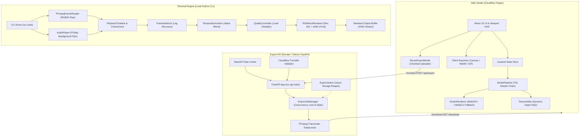

<!-- generated-by: gsd-doc-writer -->
# System Architecture

## System Overview

**RGB ASCII & Retro FX Studio** is structured as a dual-runtime media processing platform consisting of an interactive client-side web application, a headless Python terminal engine, and a cloud-hosted asynchronous transcoding backend. The architecture decouples interactive editing from computationally intensive rendering: the browser executes GPU-accelerated shaders at 60 FPS via Three.js and WebGPU/TSL with zero cloud infrastructure cost, while the Python CLI and FastAPI backend manage high-fidelity, deterministic media pipelines powered by FFmpeg subprocess pipes.

---

## Component Diagram



---

## Data Flow

### 1. Web Studio Interactive Pipeline
1. **Media Ingestion**: The user uploads an image/video or binds a webcam. A `<video>` element or `HTMLImageElement` is converted into a `THREE.VideoTexture` or `THREE.Texture` with `sRGB` color space.
2. **Pre-Tone Pass (Stage 1)**: The texture is sampled through the `preToneNode` shader, applying real-time parametric brightness, contrast, saturation, hue rotation, gamma correction, and color inversion.
3. **Primary Retro Effect (Stage 2)**: The pre-toned color node feeds into one of 16 selectable TSL effect nodes. For ASCII, the luminance maps to a horizontal glyph atlas strip; for dithering, Bayer matrices quantize colors; for matrix rain, dynamic drop lines animate across the viewport.
4. **Color Grading (Stage 3)**: Output is conditionally converted to monochrome Rec. 601 luminance and tinted with Phosphor Green (`#33ff33`), Amber CRT (`#ffb000`), or Cyan Terminal (`#00f0ff`).
5. **Post-FX Overlay (Stage 4)**: When VHS mode is selected, CRT barrel curvature, scanlines, chromatic aberration, and tape static noise are applied.
6. **Viewport Presentation**: The composited quad is drawn to an HTML5 canvas governed by a CSS transform matrix handling pan and zoom interactions.

### 2. Terminal Playback Pipeline
1. **Demuxing**: `FFmpegFrameReader` spawns `ffmpeg -i input.mp4 -f rawvideo -pix_fmt rgb24 -` and pipes raw uncompressed pixel bytes directly to standard input.
2. **Audio Concurrency**: In parallel, `AudioPlayer` launches `ffplay -vn -nodisp -autoexit` and monitors audio timeline PTS logs via stderr.
3. **Clock Synchronization**: `FrameClock` schedules frame deadlines anchored to absolute playback time (`t = start + target_time`).
4. **Frame Skipping & Adaptation**: If the rendering loop falls behind deadline, `FrameSelector` drops stale frames immediately without blocking FFmpeg pipes. Under prolonged load, `QualityController` adaptively sheds temporal smoothing, followed by ANSI color formatting, preserving pacing.
5. **Luminance & ANSI Formatting**: `RGBAsciiRenderer` calculates Rec. 601 perceived luminance (`0.299*R + 0.587*G + 0.114*B`), indexes pre-memoized glyph lookups, and writes 24-bit True Color ANSI sequences (`\033[38;2;R;G;Bm`) into an I/O buffer flushed to stdout.

### 3. Server-Side Export Pipeline
1. **Session Handshake**: Client obtains a Cloudflare Turnstile token and initializes an export session via `POST /api/export/init`.
2. **Chunked Media Streaming**: Client streams recorded WebM chunks (`POST /api/export/{job_id}/chunk`) with optional source audio uploads (`POST /api/export/{job_id}/source-audio`).
3. **FFmpeg Assembly & Transcoding**: Upon `POST /api/export/{job_id}/finalize`, `run_ffmpeg_transcode` triggers a two-pass MP4 or palettegen GIF pipeline.
4. **Delivery & Garbage Collection**: The client polls job status (`GET /api/export/{job_id}/status`) and downloads the final artifact with a single-use token (`GET /api/export/{job_id}/download`). `ExportJanitor` deletes job directories after 10 minutes or on inactivity timeouts.

---

## Key Abstractions

| Abstraction | File Location | Architectural Responsibility |
|-------------|---------------|------------------------------|
| `StudioPipeline` | `web/src/engine/Pipeline.ts` | Orchestrates the 4-stage TSL shader graph and manages uniforms. |
| `StudioRenderer` | `web/src/engine/Renderer.ts` | Manages WebGPU device acquisition and handles seamless WebGL2 fallback. |
| `TextureAtlas` | `web/src/engine/TextureAtlas.ts` | Builds and re-renders 2D canvas character ramps into a single GPU texture strip. |
| `FrameClock` | `src/timing.py` | Non-accumulating absolute deadline scheduler maintaining A/V synchronization. |
| `FrameSelector` | `src/framesel.py` | Real-time rate adapter draining decoder pipes and dropping obsolete frames. |
| `RGBAsciiRenderer` | `src/renderer.py` | Core graphics engine translating raw RGB buffers into True Color ANSI strings. |
| `ExportJobManager` | `src/api/jobs.py` | Singleton thread-safe job state machine enforcing server concurrency limits. |
| `ExportJanitor` | `src/api/janitor.py` | Periodic async worker enforcing storage quotas and purging expired export files. |

---

## Directory Structure Rationale

```text
ASCII/
├── .planning/                  # Project roadmap, state tracking, and architecture logs
├── assets/                     # Media samples and demo video fixtures for testing
├── docs/                       # Project documentation suite and database schema
├── src/                        # Core Python engine, CLI, and backend microservice
│   ├── api/                    # FastAPI application, route handlers, and transcode workers
│   │   ├── routes/             # Health check and chunked export endpoints
│   │   └── transcode.py        # FFmpeg transcode command generation and execution
│   ├── config.py               # Runtime configuration dataclass and character presets
│   ├── main.py                 # Terminal application entry point and playback loop
│   ├── renderer.py             # Luminance weighting and ANSI True Color formatting
│   ├── sync.py                 # Media timeline, A/V drift tracking, and natural exit
│   ├── timing.py               # Absolute deadline scheduling and monotonic clock wrappers
│   └── video.py                # FFmpeg subprocess piping and error classification
├── tests/                      # 435 unit and integration tests across all Python modules
├── web/                        # Single-Page Application (React 19 + TypeScript + Vite)
│   ├── src/
│   │   ├── components/         # Modular stage, rail, inspector, and modal UI components
│   │   ├── engine/             # Three.js WebGPU / TSL shader modules and texture atlas
│   │   │   └── shaders/        # Pure TSL shader nodes (ascii, dither, vhs, matrix, etc.)
│   │   ├── export/             # Client-side exporters (canvas, gifenc, mediaRecorder)
│   │   └── store/              # Zustand global studio state store and presets
│   ├── index.html              # Studio HTML shell
│   └── package.json            # Frontend dependencies and build configuration
├── pyproject.toml              # Python build specification, entry points, and test configs
├── render.yaml                 # Infrastructure-as-code definition for Render backend deployment
└── wrangler.toml               # Cloudflare Pages build and deployment configuration
```
